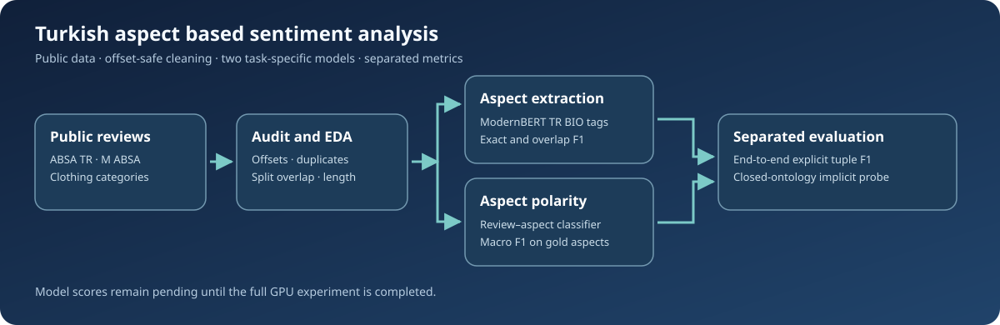

# Turkish aspect based sentiment analysis

A reproducible Turkish aspect-based sentiment analysis project with **aspect term extraction (ATE)**, **aspect polarity classification (APC)**, and a separate closed-ontology probe for implicit aspects. The default experiment uses public data only. Full GPU training and held-out model evaluation have **not yet been run**, so this repository makes no new accuracy claim.



## Google Colab

Open [Turkish_ABSA_Colab.ipynb](Turkish_ABSA_Colab.ipynb), enable a GPU runtime, and run all cells in order. The English notebook embeds its executable source and needs no repository upload. It pins the public dataset and model revisions for the run, audits and cleans training rows, produces EDA and tokenizer-length reports, trains ModernBERT-TR ATE/APC models, compares public baseline checkpoints, analyzes validation errors, and exports models plus a report bundle under `/content/absa_work`.

The notebook has **no synthetic-data generation, hand-written review fallback, or API key values**. Colab Secrets named `GEMINI_API_KEY` and `GEMINI_API_KEY_1` are not needed for this experiment. The notebook is generated from the codebase with:

```bash
python scripts/build_colab_notebook.py
```

`QUICK_MODE=True` is a plumbing check, not a publishable benchmark. Preserve the report bundle and model archive after a full run because Colab storage is temporary.

## Data and architecture

| Public source | Use | Caveat |
|---|---|---|
| [ABSA-TR](https://huggingface.co/datasets/ytu-ce-cosmos/absa-tr) | ATE, APC, held-out test | Some labels are model-generated or consensus annotations. |
| [M-ABSA Turkish](https://huggingface.co/datasets/Multilingual-NLP/M-ABSA) | ATE, APC, seven-domain held-out test | Translated, human-reviewed data; original domain splits are retained. |
| [Clothing Products ABSA](https://huggingface.co/datasets/ebrukilic/clothing_products_ABSA) | APC, held-out test | Category and polarity only; no span supervision. |

The [Turkish ABSA upload](https://huggingface.co/datasets/STNM-NLPhoenix/turkish-absa) presents one training split and entity-level labels without character offsets in its public viewer. It is not merged into the fixed span benchmark until its annotations and split strategy are audited.

- **ATE:** [ModernBERT-TR](https://huggingface.co/ytu-ce-cosmos/modernbert-tr-base) token classifier with `O/B-ASP/I-ASP` labels and class-aware loss.
- **APC:** Review–aspect pair classifier with negative, neutral, positive, and `not_mentioned` labels. The fourth class supports conservative implicit-aspect probing. Ambiguous same-target polarity pairs are excluded from APC training and scoring.
- **Implicit ontology:** Candidate categories are learned from cleaned training annotations by domain, including the English category names used by M-ABSA. Inference probes them only when a known `domain` is supplied; otherwise it returns explicit aspects only. This is a closed-vocabulary experiment.
- **Evaluation:** ATE exact and overlap F1, APC macro F1 on gold aspects, end-to-end explicit tuple F1, and a uniformly sampled implicit category–polarity score with support and ontology coverage. Public [ATE](https://huggingface.co/ytu-ce-cosmos/modernbert-tr-absa-extraction) and [APC](https://huggingface.co/ytu-ce-cosmos/modernbert-tr-absa-polarity) checkpoints are optional baselines. Scores remain separate by dataset and supervision type.

## Data quality and EDA

`stage_clean` filters only training rows. It rejects invalid offsets, non-linguistic placeholders, normalized duplicates, train-to-held-out text collisions, and high-overlap character five-gram matches against held-out reviews. The rare-shingle candidate search is approximate; it does not prove the absence of semantic duplicates. It **does not rewrite text**, preserving gold span offsets. A document with any unalignable explicit annotation is excluded in full, and exclusion counts are recorded in the manifest. Regex checks flag URLs, email, phone-like strings, HTML, zero-width characters, repeated punctuation or letters, low letter ratios, and unusually long or short reviews for inspection; flags alone do not remove rows.

`stage_eda` writes CSV tables and `eda_report.json` with source/domain and polarity distributions, span/implicit/category-only counts, aspect frequency, text lengths, duplicates, ambiguous polarity views, overlap checks, and optional exact ModernBERT truncation statistics. `scripts/audit_data.py` validates gold offsets and reports conflicting labels. Validation and test rows remain untouched.

An earlier local preparation check counted **21,565** raw training documents, **3,130** validation documents, **3,350** ABSA-TR test documents, **3,680** M-ABSA test documents, and **2,985** clothing test documents. Those counts predate the stricter alignment and near-duplicate rules and must be regenerated before publication. They are data-quality checks, **not model accuracy results**. The audit also flagged contradictory annotations for manual review.

## CLI

```bash
python run_all.py --stage smoke
python run_all.py --stage prepare
python run_all.py --stage clean
python run_all.py --stage eda --eda_tokenizer
python scripts/audit_data.py --work ./work
python run_all.py --stage train --epochs 5 --bs 8 --grad_accum 4
python run_all.py --stage eval
python run_all.py --stage export
```

`python run_all.py --stage all` executes smoke → prepare → clean → EDA → train → eval → export with public data only. Set `ABSA_WORK` to direct outputs elsewhere. Training requires GPU for a practical run and downloads public Hugging Face models.

Optional local/Gemini data generation remains in the codebase under `absa/synth_*.py` and `absa/hard_cases.py`; it is **not embedded in the Colab notebook**. It runs only with `--stage synth`, and training consumes generated files only with `--include_synthetic`. If deliberately using Gemini in a separate experiment, provide a secret through the environment; never paste a key into source or notebooks.

## Relationship to earlier work

[SemEval 2016 Task 5](https://aclanthology.org/S16-1002/) established Turkish ABSA evaluation with aspect categories, opinion targets, and polarities. Its category and target F1 plus polarity accuracy use different units and protocols from this project's exact span F1, macro polarity F1, and end-to-end tuple F1. Published SemEval scores therefore cannot be ranked against future results here. The [ModernBERT paper](https://aclanthology.org/2025.acl-long.127/) motivates the encoder architecture; the linked YTU ATE and APC checkpoints are the direct in-pipeline baselines because they can be scored on the same prepared splits. A numeric comparison will be added only after a full run.

The YTU [ATE](https://huggingface.co/ytu-ce-cosmos/modernbert-tr-absa-extraction) and [APC](https://huggingface.co/ytu-ce-cosmos/modernbert-tr-absa-polarity) cards report training on Turkish review data that include ABSA-TR teacher annotations and translated M-ABSA pairs. They are recent, relevant baselines, but training mixtures, preprocessing, and checkpoint selection differ. Their published scores are not directly comparable with this project's future outputs. The code validates checkpoint label names instead of assuming a label order.

## Reporting limits

Report dataset-level metrics, clean-data counts, alignment exclusions, package versions, seed, and GPU type. Gold-aspect APC and end-to-end tuple F1 answer different questions. APC checkpoint selection uses validation gold-pair macro F1 under the same target policy as the test, while absent-aspect negatives remain part of validation. Long reviews use overlapping token windows. The implicit score is for a training-derived, domain-specific closed ontology on a uniform document sample; report gold coverage and prevalence. The fixed ATE threshold is not calibrated. Repeated seeds, paired uncertainty estimates, a controlled ablation, and native Turkish annotation review are needed before claiming a robust performance gain on idioms, sarcasm, or informal language.
