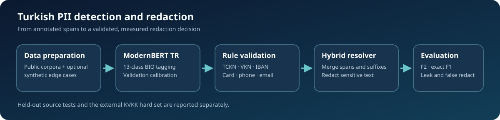

# Turkish PII detection and redaction

A hybrid Turkish personal information detector. A ModernBERT TR token classifier proposes spans, deterministic checks validate structured identifiers, and an inference layer resolves overlaps before redaction. The code supports 13 entity classes and includes training, evaluation, a FastAPI service, and a preserved Kaggle execution record.



## Reproduce the pipeline

```bash
python -m pip install -r requirements.txt
python run_all.py --stage all --no_gemini
```

The full run downloads public datasets and a pretrained encoder, trains the `clean` and `full` variants, calibrates a decision threshold on validation data, evaluates test sets, and exports the selected model. `clean` uses public corpora; `full` adds synthetic edge cases. The bundled `gemini_raw.jsonl` is a synthetic seed from the recorded run and enables a run without live Gemini requests. The recorded run generated additional Gemini examples, so using only the seed reproduces the pipeline but **not the exact historical training set or scores**. New generation is optional: supply `GEMINI_API_KEY` through the environment. No credential is stored here. `--quick` is a pipeline check, not a benchmark.

The historical run is preserved in [the executed Kaggle notebook](notebooks/kaggle_execution.ipynb) and [its text log](artifacts/kaggle_run.log). The notebook launch cell contains the original Kaggle input path. It documents that run; the source files here are the cleaned public copy. Weights, per document predictions, and plot images from the run are **not included**. Scores below can be checked against the log but cannot be independently recomputed from this repository without rerunning.

## Architecture

The model uses [ModernBERT TR base](https://huggingface.co/ytu-ce-cosmos/modernbert-tr-base) with a 13 class BIO taxonomy: person, address, phone, email, date, URL, account number, secret, TCKN, VKN, IBAN, card, and plate. `pii/rules.py` checks Turkish identity and tax numbers, IBANs, payment cards, phone numbers, and emails. `pii/infer.py` uses windowed inference for long documents, handles Turkish case suffixes, merges neural and validated rule spans, and applies redaction. Evaluation reports character overlap F2, exact span F1, leak rate, missed spans, and false redaction where available.

## Recorded results

The table uses **comparable taxonomy overlap F2** from the Kaggle log, evaluated with the same code and mapped labels for the [YTU PII checkpoint](https://huggingface.co/ytu-ce-cosmos/modernbert-tr-pii-ner). The project column is `full+hybrid`. Intervals are document bootstrap 95% intervals from that run.

| Test set | Documents | YTU baseline F2 | Project F2 | Interpretation |
|---|---:|---:|---:|---|
| [NewMind KVKK hard test](https://huggingface.co/datasets/newmindai/nm-kvkk-pii-6K) | 602 | 0.922 [0.913, 0.930] | 0.924 [0.908, 0.939] | External test; intervals overlap; no clear F2 improvement |
| [Fevzi corpus](https://huggingface.co/datasets/fevziegeyurtsevenler/turkish-pii-corpus) | 62 | 0.708 [0.621, 0.782] | 0.960 [0.926, 0.987] | Small set; regex alone reached 0.959 |
| [Belgin](https://huggingface.co/datasets/negentropi/belgin-pii-dataset) | 200 | 0.711 [0.664, 0.762] | 0.986 [0.976, 0.995] | Synthetic source; clean variant reached 1.000 |
| [BTX24](https://huggingface.co/datasets/BTX24/turkish-privacy-pii-ner) | 10,393 | 0.557 [0.549, 0.565] | 0.986 [0.984, 0.989] | 73.35% test template skeleton overlap with training |
| [Yusuf privacy filter](https://huggingface.co/datasets/yusuf-said/turkish-privacy-filter-dataset) | 405 | 0.548 [0.521, 0.573] | 0.997 [0.993, 1.000] | Synthetic or curated; investigate template similarity |

On the external KVKK hard test, the project also recorded **0.828 exact span F1**, **0.0044 character leak rate**, and **0.0070 missed span rate** in the comparable taxonomy. The YTU baseline exact F1 was 0.534 in this evaluation. This difference does not establish overall superiority: overlap F2 is similar, label mapping and span boundaries matter, and there is no paired significance test.

Synthetic stress results are useful for failure analysis, not independent validation: `full+hybrid` reached 0.870 F2 on Gemini generated edge cases and 0.990 on locally generated cases. The Gemini stress set had a **0.433 false redaction rate** for the project. This is a substantial precision risk before use with real user text.

## Relationship to prior work

The strongest fair comparison here is the [YTU PII model](https://huggingface.co/ytu-ce-cosmos/modernbert-tr-pii-ner) evaluated by the **same script and taxonomy mapping** above. The [ModernBERT paper](https://aclanthology.org/2025.acl-long.127/) motivates the encoder architecture; it is not a Turkish PII benchmark. The [NewMind KVKK dataset card](https://huggingface.co/datasets/newmindai/nm-kvkk-pii-6K) documents the external test source. The [Horizon Labs model card](https://huggingface.co/Horizon-Labs/pii-redactor-base) reports a Turkish redaction F1 of 0.851 on a KVKK evaluation, but its label policy and F1 calculation differ from this project's overlap F2, so the numbers cannot be ranked directly. Published scores on other model cards may likewise use different splits, labels, or metrics.

The evidence supports a working, instrumented pipeline and a promising exact boundary result on KVKK. It does **not** support a state of the art claim. A stronger release would include rerun weights, predictions, package versions, and a paired evaluation on independently annotated Turkish text.

## Files

`pii/` contains data preparation, synthetic generation, model training, inference, rules, metrics, and plotting. `run_all.py` orchestrates stages, `kaggle_run.py` launches on Kaggle, and `serve.py` serves redaction. `notebooks/` and `artifacts/` hold the execution evidence.
